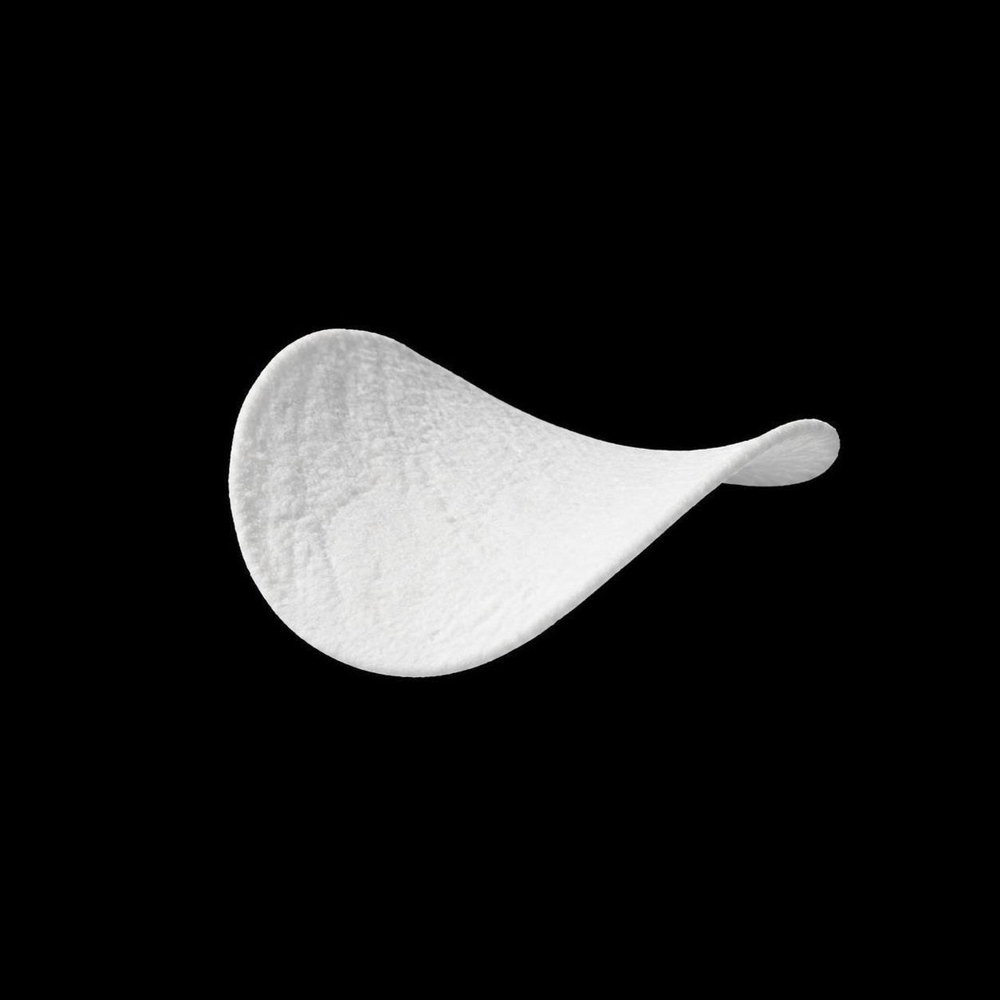

# OmniCrawl

<p align="center">
  
</p>

OmniCrawl 是一个本地运行的 AI 编程助手终端工作台，产品本体是纯 Rust 二进制：提供全屏 TUI 与本地 HTTP/SSE API。它以 Agent 循环方式执行任务：理解目标 → 读取项目文件 → 搜索文本 → 编写或修改文件 → 执行命令。工具审批默认采用「自动审查」：删除类、下载并执行类调用与高风险 Git 操作交给独立审查模型判定，也可切换为逐次人工确认或完全自动批准。

## 功能特性

- **终端 TUI**：Rust 全屏工作台（`omnicrawl-tui`），键盘与鼠标交互，内置模型热切换、渠道管理、设置面板、审批控制、事务式 `/undo` 回退、取消回合上下文保留。
- **HTTP/SSE API**：本地服务可对接 Web 或桌面前端，`Swagger UI` 文档开箱即用。
- **工具与安全**：内置文件读写、文本搜索、本地图片读取、视觉模型代理、Bash/PowerShell、Windows 桌面控制、记忆与 SubAgent 等工具，可在 `config.toml` 的 `tools` 段逐工具开关；SubAgent 支持独立 Git worktree 隔离执行。子代理全局设置与每个子代理的模型选择放在独立的 `subagents.toml`（模板见 `rust/assets/config-templates/subagents.example.toml`），已从 `config.toml` 完全迁移，不再回退读取 `config.toml` 的 `[subagents]` 段。
- **统一工具分发**：Provider 顶层注册当前 Agent 的全部可见工具，模型直接以真实工具名原生调用；完整 Schema、审批策略、MCP 能力与执行器由 Host 侧目录持有并二次校验，详见 `rust/assets/docs/TOOL_CALLING.md`。
- **可扩展**：支持 NPM Hook 插件、Skill 技能、MCP Server 接入，以及自定义 `models.toml` 模型目录。

## 环境要求

- 产品是 Rust 二进制；插件功能需要 Node.js 20+
- 从源码构建需要 Rust 1.90+（工作区 MSRV）；

## 安装

```powershell
npm install -g omnicrawl-cli   # 启动器 + 平台包（内核 + 宿主载荷，纯 Rust 二进制）
omnicrawl                      # 全屏 TUI
```

平台包按 `os/cpu` 分发：`@omnicrawl/cli-win32-x64`、`cli-win32-ia32`、`cli-linux-x64`、
`cli-linux-arm64-musl`、`cli-linux-arm-musl`（后两个分别覆盖 arm64 与 armv7）

### 从源码构建

```powershell
git clone https://github.com/cccchiban/omnicrawl.git
cd omnicrawl/rust
cargo build --release -p omnicrawl-cli      # 内核（协议 v1 NDJSON）
cargo test --workspace                      # 工作区测试
```

宿主载荷（`omnicrawl-host` 统一入口 + 内核 + TUI + API + 决策接口 + MCP Server）由
`node packages/cli/scripts/build-host.mjs` 装配，`prepare.mjs` 组装 npm 产物；交叉编译与
各平台前置见 `rust/docs/python-free-build.md`。

## 启动

### 终端 TUI

```powershell
omnicrawl
```

`omnicrawl` 就是产品入口（npm 启动器，按平台包解析到 Rust 宿主）；同一条命令还提供
`omnicrawl api`（本地 HTTP/SSE 服务）、`omnicrawl decision`（结构化决策模型本地服务）、
`omnicrawl plugin`（插件管理）与 `omnicrawl kernel`（直接跑协议内核）等子命令。

首次启动会跑一个行式向导，为当前渠道填写渠道名、Provider（OpenAI、Anthropic、Gemini）、协议、Base URL、模型 ID 与凭据环境变量名，配置保存在本机 `~/.OmniCrawl`；其余字段可在 `/settings` 里继续修改。配置好一个已启用且具备 Key 的默认渠道后，`omnicrawl` 即可进入工作台。

如果本机配置了 Telegram（Bot Token + 授权用户 ID）、飞书（App ID + App Secret）或
MQTT（`[mqtt]` 段的 broker、topics 与 actions 齐全），启动 TUI 时会自动拉起对应的独立
连接器子进程；未配置的平台不会启动，连接器故障不阻塞 TUI，退出 TUI 时会自动回收连接器。
同一平台同一用户只允许一个活动连接器实例：多个 TUI/API 进程并存时，后启动方会自动跳过，
避免重复长连接。设置 `OMNICRAWL_AUTO_START_CONNECTORS=0` 可关闭该联动。
MQTT 不是聊天平台：它由遥测事件触发，用规则 + 决策模型决定开关棚/通风/灌溉，见
`rust/assets/docs/MQTT.md`；Telegram/飞书的配置方法与安全边界见
`rust/assets/docs/TELEGRAM.md`、`rust/assets/docs/FSAPP.md`。

常用操作：

- `Enter` 发送，`Ctrl+J` 换行；`Esc` 取消当前回合或清空输入
- `/model <key|profile/model_id|model_id>` 切换模型；`/settings` 打开设置与渠道管理；`/approval:auto|manual|review` 切换审批模式
- `/new` 开启新对话，`/sessions` 查看会话列表，`/compact` 压缩上下文，`/undo` 事务式回退上一轮
- `/skills`、`/mcp`、`/plugins` 查看技能、MCP 与插件状态
- `Ctrl+L` 清空当前视图，`Ctrl+Q` 退出

### 本地 HTTP/SSE API

在 `~/.OmniCrawl/config.toml` 里配置令牌：

```toml
[api]
bearer_token = "请替换为随机长令牌"
host = "127.0.0.1"
port = 8765
```

```powershell
omnicrawl api
```

默认监听 `127.0.0.1:8765`，Swagger UI 位于 `http://127.0.0.1:8765/docs`，机器可读契约位于 `/openapi.json`。除健康检查与文档外，所有接口需携带 `Authorization: Bearer <token>`。服务只接受回环地址，令牌为空或 CORS 来源使用 `*` 时拒绝启动。完整接入说明见 `rust/assets/docs/API.md`。

## 项目结构

```text
omnicrawl/
├── rust/                       # 产品本体：内核 + 宿主 + TUI + API + MCP（纯 Rust）
│   ├── crates/omnicrawl-entry/     # 统一入口（omnicrawl-host）：路由 TUI / api / decision / plugin / kernel / connector
│   ├── crates/omnicrawl-cli/       # 内核进程（协议 v1 NDJSON）
│   ├── crates/omnicrawl-tui/       # 全屏终端工作台
│   ├── crates/omnicrawl-host/      # 宿主：工具执行、审批、审查
│   ├── crates/omnicrawl-api/       # 本地 HTTP/SSE 服务
│   ├── crates/omnicrawl-mcp/       # MCP Server
│   ├── crates/omnicrawl-decision/  # 结构化决策模型本地服务
│   ├── crates/omnicrawl-tts/       # 语音合成
│   └── assets/docs/                # 内置技术文档（omnicrawl://docs/）
├── packages/                   # npm 分发：启动器（平台包在发布产物中生成）、插件 SDK/Host
├── assets/                     # 仓库级素材（logo 等）
└── tests/                      # npm 插件夹具
```

## 开源协议

本项目基于 [MIT License](LICENSE) 开源发布。

```
MIT License

Copyright (c) 2026 cccchiban

Permission is hereby granted, free of charge, to any person obtaining a copy
of this software and associated documentation files (the "Software"), to deal
in the Software without restriction, including without limitation the rights
to use, copy, modify, merge, publish, distribute, sublicense, and/or sell
copies of the Software, and to permit persons to whom the Software is
furnished to do so, subject to the following conditions:

The above copyright notice and this permission notice shall be included in all
copies or substantial portions of the Software.

THE SOFTWARE IS PROVIDED "AS IS", WITHOUT WARRANTY OF ANY KIND, EXPRESS OR
IMPLIED, INCLUDING BUT NOT LIMITED TO THE WARRANTIES OF MERCHANTABILITY,
FITNESS FOR A PARTICULAR PURPOSE AND NONINFRINGEMENT. IN NO EVENT SHALL THE
AUTHORS OR COPYRIGHT HOLDERS BE LIABLE FOR ANY CLAIM, DAMAGES OR OTHER
LIABILITY, WHETHER IN AN ACTION OF CONTRACT, TORT OR OTHERWISE, ARISING FROM,
OUT OF OR IN CONNECTION WITH THE SOFTWARE OR THE USE OR OTHER DEALINGS IN THE
SOFTWARE.
```
